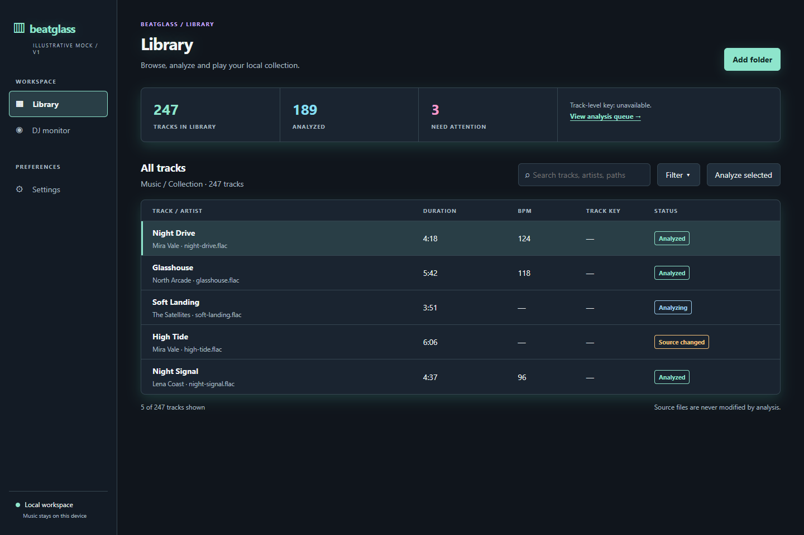
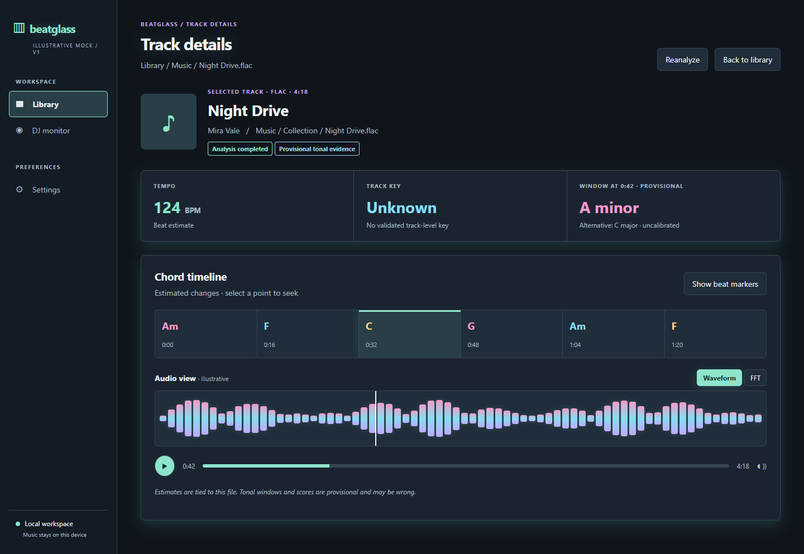
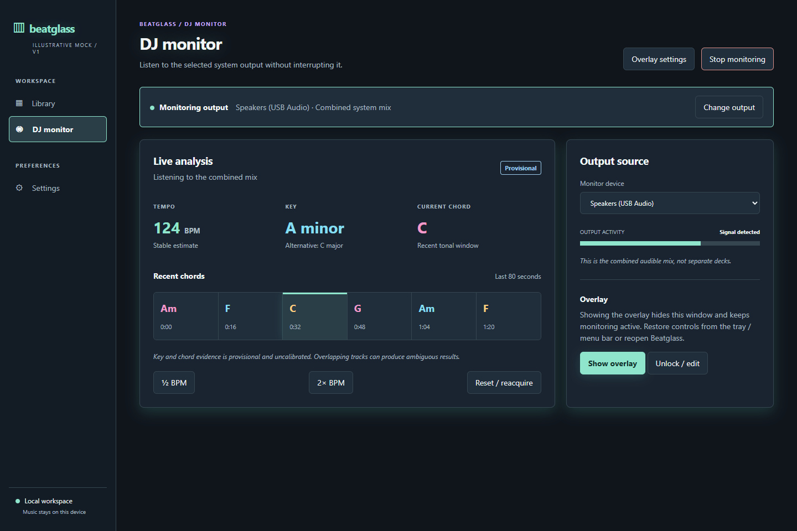
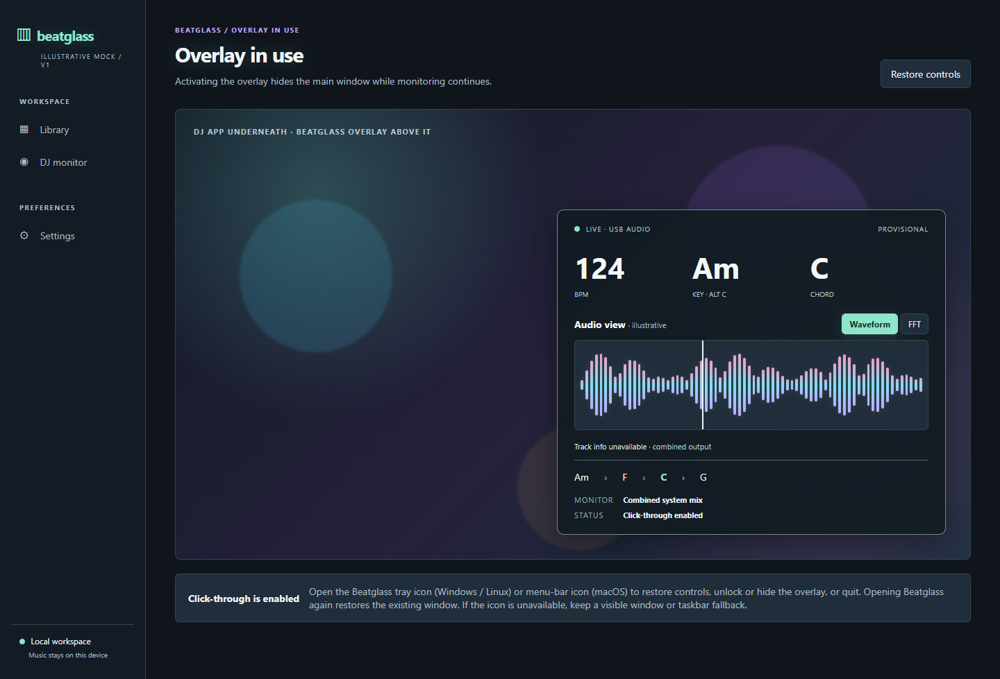

# Beatglass

<p align="center"><strong>Desktop music analysis and DJ monitoring, in one focused workspace.</strong></p>

<p align="center">
  
  
  
  
</p>

These four screens are the current v1 prototype renderings: the desktop library, track analysis, DJ monitoring, and floating overlay. They are illustrative design-system renders, not native-platform qualification evidence. See [`design/v1`](design/v1/) for the source, states, tokens, and reproducible Playwright renderer. The overlay design-system evidence gallery is [`docs/overlay-design-gallery.md`](docs/overlay-design-gallery.md); it indexes the committed workflow/component renderings and native screenshot qualification states.

Decoder snapshot validation is fail-closed: a retry is eligible only when the persisted `decoder_snapshot` is non-empty and matches the active decoder identity. Empty legacy snapshots and mismatched snapshots are rejected; they must be re-analyzed to establish fresh provenance.

`decoder_snapshot` is a compatibility anchor for retryable analysis. A persisted run may be resubmitted only when its snapshot matches the active decoder/configuration contract; legacy rows with an empty snapshot are rejected conservatively until re-analysis establishes fresh metadata.

Retryable analysis storage schema v2 persists `source_path` and `decoder_snapshot` beside content/engine/configuration/mode identity. The recovery bridge uses these fields for metadata-gated coordinator resubmission; missing or mismatched metadata remains a rejection.

Beatglass is a local desktop music analysis application with a Library for analyzing files and a DJ mode that monitors a selected system output and displays live musical estimates. The integrated prototype now includes the desktop shell, source-attributed analysis lifecycle, persistent SQLite Library cache/recovery, bounded batch submission, source-PCM waveform/FFT views, DJ evidence/reacquisition states, native Windows/macOS playback/capture paths, bounded Linux PipeWire playback/capture, and platform recovery contracts. End-to-end production parity and full native qualification remain in progress.

The implementation is C++20. C callers can interoperate today through the
documented CLI/process boundary; a stable C ABI adapter is not yet shipped.
Objective-C callers can invoke that boundary from `.m`, while
Objective-C++ callers can bridge to C++ headers from `.mm`. ABI stability is
not yet promised.

Minimal C integration (using the installed C adapter) looks like:

```c
#include <stdlib.h>

int main(void) {
    return system("beatglass-tool --json song.wav");
}
```

The intended stack is C++20, CMake, Qt 6 Quick, SQLite, aubio and Essentia, with PipeWire, Core Audio taps and WASAPI loopback for Linux, macOS and Windows respectively. Dependency availability, versions and licenses must be verified before selection. No account or network service should be required at runtime.

## Current status and prerequisites

This repository is beyond initial groundwork but is not yet a completed v1. Shared contracts, CTest coverage, the Qt desktop shell, analysis lifecycle controls, queue capacity reporting, visualization modes, and truthful recovery states are integrated incrementally; see [progress](docs/progress.md) and [decisions](docs/decisions.md). Native audio, overlay, and full workflow qualification remain pending and are not inferred from headless tests.

Production implementation belongs in `src/` for applications and `lib/` for reusable libraries, with library headers in `include/beatglass/`, tests and fixtures in `tests/`, and documentation in `docs/`. See issue #1 for the complete specification, acceptance criteria and phased execution plan.

The desktop shell currently exposes six persisted appearance themes (Light, Dark, High contrast, Purple, Blue, and Yellow) plus a reduced-motion preference; native QML palette values are aligned with the `design/v1` tokens, while native desktop qualification remains pending.

The current `main` branch includes the bounded analysis queue and retry lifecycle, persistent CLI Library cache/recovery, source-PCM waveform/FFT controls, selectable themes and accessible preference/overlay recovery controls, DJ evidence/reacquisition messaging, Windows endpoint-loss recovery, native macOS AudioUnit playback/CoreAudio Live integration, and bounded Linux PipeWire playback/capture integration. These are implemented slices, not a v1 completion claim: optional tonal dependencies and interactive/native qualification remain open.

## Build and test the groundwork

Install a C++20 compiler, CMake 3.24 or newer, and Git/network access for the pinned Catch2 download. From the repository root:

```sh
cmake -S . -B build -DBUILD_TESTING=ON
cmake --build build --config Debug
ctest --test-dir build -C Debug --output-on-failure
```

For a targeted build, build the aggregate test target first so every
CTest-discovered executable exists:

```sh
cmake --build build --target beatglass_all_tests --config Debug
ctest --test-dir build -C Debug --output-on-failure
```

The default builds the dependency-light foundation tests. To build the CLI and desktop prototype, install aubio, libsndfile, SQLite, and Qt 6 development packages and configure with `-DBEATGLASS_BUILD_SLICE=ON -DBEATGLASS_BUILD_DESKTOP=ON`. For the issue #4320 terminal prototype, enable the vcpkg `tui` feature and configure with `-DBEATGLASS_BUILD_SLICE=ON -DBEATGLASS_BUILD_TUI=ON`; persistent SQLite Library storage is enabled by default (set `-DBEATGLASS_BUILD_LIBRARY_PROTOTYPE=OFF` only for a dependency-light build without cache/recovery), and `beatglass-cli [audio-folder]` browses local files and launches real analysis. The single-file utility is named `beatglass-tool`. For example on Ubuntu 22.04:

```sh
sudo apt-get install libaubio-dev libsndfile1-dev qt6-declarative-dev libgl1-mesa-dev qml6-module-qt-labs-folderlistmodel qml6-module-qttest qml6-module-qtquick qml6-module-qtquick-controls qml6-module-qtquick-dialogs qml6-module-qtquick-layouts qml6-module-qtquick-window qml6-module-qtquick-templates qml6-module-qtqml qml6-module-qtqml-models qml6-module-qtqml-workerscript
cmake -S . -B build -DBUILD_TESTING=ON -DBEATGLASS_BUILD_SLICE=ON -DBEATGLASS_BUILD_DESKTOP=ON -DBEATGLASS_TEST_V1_CODECS=OFF
cmake --build build
ctest --test-dir build --output-on-failure
./build/beatglass-tool /path/to/file.wav
./build/beatglass-desktop
```

For Windows the experimental CLI was built with MSVC and vcpkg's `aubio[core]` and `libsndfile[core]` packages by passing `-DCMAKE_PREFIX_PATH=<vcpkg>/installed/x64-windows` and the options above; use matching Debug or Release configuration for build and CTest. An experimental LLVM/Clang toolchain can also be installed with Scoop (`scoop install llvm`) and selected through CMake's `-T ClangCL` generator toolset or an explicit `CMAKE_CXX_COMPILER`; this is a development option, not a pinned qualification environment. Ubuntu 22.04 ships a libsndfile older than the 1.1.0 MP3 support baseline; this example skips the v1 codec integration test and is not format qualification. This system-installed dependency setup is not pinned and these are development instructions, not a release recipe; the experimental manifest pins a separate configuration below.

The terminal prototype has two distinct executables. `beatglass-tool` is the
single-file analyzer, while `beatglass-cli` is the FTXUI application:

```text
beatglass-tool [--help] [--version] [--replay] [--json] [--] <audio-file>
beatglass-cli [audio-folder]
beatglass-cli --snapshot <audio-folder> [library|live|settings]
```

The TUI opens with Library, Live, and Settings tabs. Library recursively browses
supported files, runs real decoder/aubio analysis asynchronously, can analyze all
currently visible filtered tracks sequentially with shared cancellation and
progress, isolates per-track decoder errors so one corrupt file does not abort the
batch, clears a stale failure badge when retrying a track succeeds, sorts the visible collection by title or path while preserving selection
identity, provides a case-insensitive search across title, filename, and full path, performs a safe metadata preflight so duration/format are visible before analysis, shows filtered visible/analyzed/failed counts, renders a colored PCM waveform with analyzer-detected beat frames and playback position, and recursively indexes folders selected through either path entry or the native picker. It exposes native
folder selection and Windows/macOS/Linux playback controls when the corresponding
native backend is built. Live discovers Windows
render sinks, macOS CoreAudio output sources, or Linux PipeWire sinks when the
corresponding backend is built; it captures the selected OS output through the
native backend and displays real tempo, telemetry, and a colored live waveform.
Live also exposes explicit
half/normal/double tempo interpretation and reset/reacquire controls. Settings
controls reduced motion and the seek step. Mouse tab selection and `Tab`/`1`/`2`/`3` keyboard
navigation are supported; terminals below 100 columns or 28 rows show a clear
resize prompt. Standard builds display explicitly provisional FFT-derived
key/chord estimates with bounded recent tonal history; when
`BEATGLASS_BUILD_MUSIC_REPLAY=ON` is enabled with Essentia, Library and Live
analysis use the optional causal tonal replay path and display its higher-fidelity
key/chord estimates. Neither path claims calibrated confidence or full-mix
musical accuracy yet.

Library keyboard shortcuts include `a` for Analyze all visible, `r` for refresh,
`s` for sort, and `o` for the folder action; text inputs retain normal character
editing when focused. The TUI never writes tags or modifies source audio. Native
desktop, capture, playback, and overlay qualification
remain platform-specific work; see [macOS overlay status](docs/macos-overlay.md)
and [the macOS qualification checklist](docs/macos-qualification.md).

On Linux, `-DBEATGLASS_BUILD_PIPEWIRE=ON` builds PipeWire sink discovery/capture and bounded native playback plus their CTest coverage; install the PipeWire development package first (for Ubuntu, `libpipewire-0.3-dev`). A real daemon qualification run remains open. See [Linux platform status](docs/linux-platform-increment.md).

The shipped `beatglass-cli` and `beatglass-music-cli` report decoder/analysis
failures on stderr with an `error: ` prefix and exit with status 1;
argument/usage errors exit with status 2.

## Qualification evidence index

Use [progress](docs/progress.md) for the implementation ledger and open work,
[platform qualification status](docs/platform-qualification-status.md) for the
current evidence boundary and remaining gates, and the platform handoff plans
for [Windows](docs/windows-qualification.md), [macOS](docs/macos-qualification.md),
and [Linux](docs/linux-qualification-plan.md). Portable checks prepare these
handoffs; they do not substitute for retained native evidence.

Portable evidence boundary checks:

```text
python tests/platform/check_cli_evidence_status.py
python tests/platform/check_progress_cli_evidence.py
python tests/platform/check_qualification_index.py
```

## Command-line and qualification-tool options

The following reference is generated from the authoritative parsers in
`src/cli/main.cpp`, `src/desktop/main.cpp`, and `tests/platform/*.py`. Paths
are read-only unless an option explicitly names an output; tools fail closed
with a nonzero exit status and report errors on stderr.

### Binary command-line flags

These are the only options accepted by the shipped `beatglass-tool` and
`beatglass-desktop` binaries. They are separate from the developer and
qualification-script flags below.

Usage: `beatglass-tool [--help] [--version] [--replay] [--json] [--] <audio-file>`.
The music analysis binary uses `beatglass-music-cli [--help] [--version] <audio-file>`.

| Binary | Argument | Meaning |
| --- | --- | --- |
| `beatglass-tool` | `<audio-file>` (required) | Analyze one audio file without modifying it. |
| `beatglass-tool` | `--help`, `-h` | Print usage and exit successfully. |
| `beatglass-tool` | `--version`, `-V` | Print the project version and exit successfully. |
| `beatglass-music-cli` | `--version`, `-V` | Print the project version and exit successfully. |
| `beatglass-music-cli` | `--help`, `-h` | Print usage and exit successfully. |
| `beatglass-tool` | `--replay <file>` | Run causal replay without real-time pacing. |
| `beatglass-tool` | `--json` | Emit one JSON result, or JSON Lines when combined with `--replay`. |
| `beatglass-tool` | `--` | End option parsing so a filename beginning with `-` is accepted. |
| `beatglass-desktop` | `--database <path>` | Select the SQLite storage path; the first occurrence wins. |

Unknown options, missing values, duplicate `--replay`/`--json`, and a missing
`<audio-file>` return status 2 and print usage/error text to stderr. `--json`
and `--replay` may be combined. The desktop binary passes unrelated arguments
through to Qt after consuming `--database`.

### Developer and qualification-script flags

The following options belong to repository tools and are not accepted by the
shipped binaries.

| Command | Option | Default / values | Behavior and interactions |
| --- | --- | --- | --- |
| `beatglass-tool` | `<audio-file>` | required positional path | Analyzes one input; the input is never modified. |
| `beatglass-tool` | `--replay <file>` | off | Emits incremental causal estimates without real-time pacing; may end with a partial JSON-Lines stream on error. |
| `beatglass-tool` | `--json` | off | Emits one JSON result, or JSON Lines with `--replay`; `bpm` may be `null`. |
| `beatglass-tool` | `--` | none | Ends option parsing so an input beginning with `-` is treated as a path. |
| `beatglass-desktop` | `--database <path>` | application default | Selects the SQLite storage path; the first occurrence wins and later arguments are passed to Qt. |

Unknown CLI options, missing values, duplicate `--replay`/`--json`, and a
missing audio path exit with status 2. `--json` and `--replay` may be combined.

### Readiness, evidence, and release tools

| Tool | Positional arguments | Options (default) |
| --- | --- | --- |
| `check_evidence_readiness.py` | `--status`, `--bundles` (both required) | `--report` (none), `--max-age-hours` (168; must be positive), `--max-report-bytes` (16 MiB), `--json` (off) |
| `generate_readiness_report.py` | `bundles output` | `--max-report-bytes` (16 MiB), `--json` (off) |
| `run_readiness_handoff.py` | `bundles output` | `--status`, `--max-age-hours` (168), `--check-docs`, `--consume`, `--native-output`, `--native-platform {windows,macos,linux}`, `--review-output`, `--require-ready`, `--review-json`, `--consume-review`, `--decision-output`, `--native-review-output`, `--native-reviewer` |
| `ingest_qualification_artifacts.py` | `root output` | `--max-artifact-bytes` (1 GiB), `--max-manifest-bytes` (16 MiB), `--max-entries` (1000), `--max-total-artifact-bytes` (8 GiB), `--json` |
| `verify_evidence_bundle.py` | `--root`, `--manifest` (both required) | `--max-artifact-bytes` (1 GiB), `--max-manifest-bytes` (16 MiB), `--max-entries` (1000), `--max-total-artifact-bytes` (8 GiB), `--json` |
| `validate_readiness_report.py` | `report` | `--bundles` (none; enables retained-bundle verification) |
| `consume_readiness_handoff.py` | `report` | none |
| `consume_review_packet.py` | `packet` | `--report` (none) |
| `consume_review_bundle.py` | `bundle` | `--report-name` (`readiness-report.json`), `--packet-name` (`review.json`) |
| `review_readiness_handoff.py` | `report output` | `--require-ready`, `--json-output` (none) |
| `review_release_decision.py` | `bundle output` | none |
| `review_native_evidence.py` | `report reviewer output` | none |
| `retain_review_bundle.py` | `report packet destination` | none |
| `promote_review_bundle.py` | `source destination` | none |
| `record_release_signoff.py` | `decision reviewer output` | none |
| `prepare_release_bundle.py` | `report packet retained release` | `--signoff` (none; when present, required and verified) |
| `verify_release_manifest.py` | `release_root` | `--signoff` (none; requires and verifies manual signoff when present) |
| `verify_release_bundle.py` | `release_root` | none |

The readiness chain is intentionally ordered: ingest/retain evidence, run the
handoff, review/consume the decision, record signoff, promote, then verify the
manifest and final release bundle. `--require-ready` and `--consume-review`
are conservative gates; they do not replace native platform evidence.

### PipeWire and qualification helper flags

The Linux/native helper scripts are also user-facing and are covered by the
same reference:

| Tool | Flags |
| --- | --- |
| `tests/pipewire/check_linux_native_prerequisites.py` | `--report <path>` |
| `tests/pipewire/run_linux_native_qualification.py` | `--source <path>` (repository root), `--build <path>` (`build-pipewire`), `--summary <path>`, `--transitions <path>`, `--archive <path>`, `--capture-plan <path>`; `--archive` requires `--summary` |
| `tests/pipewire/qualification_matrix.py` | `--summary <path>` |
| `tests/pipewire/validate_qualification_artifacts.py` | `--json` |
| `tests/platform/verify_evidence_bundle.py` | `--root`, `--manifest`, `--max-artifact-bytes`, `--max-manifest-bytes`, `--max-entries`, `--max-total-artifact-bytes`, `--json` |
| `tests/platform/validate_readiness_report.py` | `--bundles` |
| `tests/platform/verify_release_manifest.py` | `--signoff` |

`--report`, `--summary`, `--transitions`, `--archive`, and `--capture-plan`
write evidence only when their parent workflow reaches that stage. PipeWire
qualification remains pending until a real native host run supplies the
artifacts; `--json` changes output format and does not claim qualification.

### CMake configuration flags

The documented CMake feature switches are `-DBUILD_TESTING=ON`,
`-DBEATGLASS_BUILD_SLICE=ON`, `-DBEATGLASS_BUILD_DESKTOP=ON`,
`-DBEATGLASS_BUILD_PIPEWIRE=ON`, `-DBEATGLASS_BUILD_TONAL_SPIKE=ON`,
`-DBEATGLASS_BUILD_MUSIC_REPLAY=ON`,
`-DBEATGLASS_BUILD_LIBRARY_PROTOTYPE=ON`,
`-DBEATGLASS_BUILD_LIBRARY_FINGERPRINT=ON`,
`-DBEATGLASS_FETCH_SQLITE3=ON`, and `-DBEATGLASS_TEST_V1_CODECS=OFF`.
These are experimental build switches, not runtime CLI flags; combine only
the options described by each section above.

On Windows, Scoop's main bucket can be made explicit before installing the
experimental LLVM toolchain:

```powershell
scoop bucket add main
scoop install llvm
clang --version
clang-cl --version
cmake -S . -B build-clang -G "Visual Studio 17 2022" -A x64 -T ClangCL
```

The compiler selection and Scoop package are development conveniences, not a
cross-platform qualification result or a pinned release toolchain.

### Complete repository flag inventory

The repository also invokes downstream tool flags while running qualification
helpers. They are intentionally documented here so copy/paste commands are
auditable: `--backend-*` (CMake backend selector), `--cflags`, `--libs`,
`--modversion`, and `--exists` belong to `pkg-config`; `--show-only` and
`--no-tests` belong to CTest discovery; `--output-junit`, `--timeout`, and
`--version` are native-test runner options; `--output-on-failure` and
`--test-dir` are CTest options; `--keep-going` belongs to Sphinx; and
`--variable` belongs to the CMake metadata helper. These are downstream tool
options, not Beatglass parser flags, but they are part of the reproducible
qualification commands. The repository-wide checker below verifies that this
entire set, plus every Beatglass-defined flag, remains visible in this file.
The native matrix helper also accepts `--record` when recording a qualification
attempt; it is distinct from the evidence `--report` output.

## API documentation

The [published documentation site](https://zfogg.github.io/beatglass/) combines three documentation tools:

- [MyST](https://myst-parser.readthedocs.io/) keeps the project, engineering, qualification and design documents in Markdown while giving Sphinx navigation, search and cross-links.
- [Hawkmoth](https://hawkmoth.readthedocs.io/) extracts documented declarations from the provisional library and private `src/` and `lib/` C++ interfaces.
- [Sphinx](https://www.sphinx-doc.org/) assembles both sources into one searchable site. The site uses a custom dark theme with pastel mint, lavender and peach accents, plus a styled green scrollbar.

Indexing a private header does not install it. Check header coverage with `python docs/api/check_headers.py` and `python tests/unit/check_headers_test.py`. Build the same Linux container used by CI from the repository root (Docker required):

```sh
docker build -f docs/api/Dockerfile -t beatglass-docs .
docker run --rm -v "$PWD:/work" beatglass-docs sphinx-build -W --keep-going -b html -c docs/api . /work/build/docs/html
```

Open `build/docs/html/index.html`. On Windows PowerShell, use `${PWD}` in the volume argument. Python dependencies, the base image, and direct Clang, Python, pkg-config and Qt packages are pinned. Ubuntu transitive packages still come from live repositories; archived packages may be needed if pinned versions disappear. Pull requests validate the build; pushes to main deploy it through GitHub Pages when Pages is configured for GitHub Actions. The documentation does not establish native platform qualification or API stability.
### Pinned development dependencies (experimental)

`vcpkg.json` pins the registry baseline and requests aubio without its tool dependencies and libsndfile with FLAC/Vorbis/Opus and MPEG features. Set `VCPKG_ROOT` to a vcpkg checkout containing the baseline, then run `cmake --preset vcpkg-core`, `cmake --build --preset vcpkg-core`, and `ctest --preset vcpkg-core`. The optional `vcpkg-desktop` preset enables the manifest's Qt feature. These presets are not yet verified across all platforms or configurations and do not establish a release distribution or codec coverage. Codec integration tests are enabled by default; set `-DBEATGLASS_TEST_V1_CODECS=OFF` only for a development system whose libsndfile lacks those codecs, and do not count that as format qualification. The CLI also accepts `--replay <file>` to print incremental estimates after observed blocks, without real-time pacing. See [contracts and handoff](docs/contracts.md), the [provisional PipeWire status contract](docs/pipewire-status-contract.md), and the [Linux qualification plan](docs/linux-qualification-plan.md).

The [Phase 0 gate audit](docs/phase0-gate.md) records the coordinator's acceptance for starting Phase 1 and remaining gaps. The current experimental shell is not the full application.

See the [platform qualification status](docs/platform-qualification-status.md) for executable preparation checks and the native gates that remain open on Windows, macOS, and Linux. Its versioned readiness report (`readiness_report_schema: 1`) is fail-closed: incomplete or unrun scenarios produce `PENDING`/a nonzero checker result, and the report cannot promote the repository's explicitly experimental support language without actual native desktop, audio, and overlay evidence.

The executable handoff path is: ingest native script output with `tests/platform/ingest_qualification_artifacts.py`, run `tests/platform/run_readiness_handoff.py` to generate and validate the report, then consume it with `tests/platform/consume_readiness_handoff.py`. These tools preserve `PENDING` until native evidence is reviewed; portable tests and dry runs do not qualify hardware.

For an acceptance review, add `--review-output review.md --require-ready` to the handoff command. It exports the human checklist and fails closed while any native gate remains pending.

For automated review, pair `--review-json review.json --consume-review --decision-output decision.json` with the same handoff command; the versioned packet consumer validates the exported review artifact and writes a conservative `ACCEPTED`/`PENDING` decision before release automation can proceed. Native evidence remains required for acceptance.

The standalone decision consumer is `tests/platform/review_release_decision.py <bundle-root> <decision.json>` for already-retained canonical bundles.

Release automation may promote only an accepted bundle with `tests/platform/promote_review_bundle.py <bundle-root> <release-root>`. The command refuses `PENDING` decisions, leaves the release destination untouched, writes `release-manifest.json` with the promoted report and packet SHA-256 values, and verifies that manifest before reporting success.
Downstream release jobs should verify that artifact with `tests/platform/verify_release_manifest.py <release-root> --signoff signoff.json` before publishing; any changed, missing, or unsigned file fails closed.
The final release-directory check is `tests/platform/verify_release_bundle.py <release-root>`; it requires the retained signoff and verifies the complete report/packet/manifest/signoff set together.
Native review owners can record the remaining qualification assessment with `tests/platform/review_native_evidence.py <report.json> <reviewer> <native-review.json>`; incomplete scenarios remain `PENDING` and are listed as blockers.
The handoff command can emit the same assessment with `--native-review-output native-review.json --native-reviewer <reviewer>`, keeping the report and qualification review artifacts from one run.
The one-command workflow `tests/platform/prepare_release_bundle.py <report.json> <review.json> <retained-root> <release-root> --signoff signoff.json` runs retention, decision, promotion, and dual-hash signed manifest verification in order, then retains `signoff.json` beside the release artifacts; pending native evidence or mismatched human approval stops before release output.
After an accepted decision, record manual release ownership with `tests/platform/record_release_signoff.py <decision.json> <reviewer> <signoff.json>`; the signoff binds both report and review-packet hashes, and pending decisions cannot receive a signoff.
The signed release checklist is therefore: retain the pair, emit the decision, record signoff, run the signed `prepare_release_bundle.py` workflow, and verify the dual-hash manifest before publication.

## Qt 6.8.3 prebuilt desktop preset

With a clean vcpkg root and the selected Qt 6.8.3 SDK, set `VCPKG_ROOT` to the pinned vcpkg checkout and `BEATGLASS_QT_ROOT` to the SDK's compiler-specific directory (the directory containing `lib/cmake/Qt6`). From a fresh build directory run:

```sh
cmake --preset prebuilt-qt-desktop
cmake --build --preset prebuilt-qt-desktop
ctest --preset prebuilt-qt-desktop
```

On Windows with Visual Studio, add `-G "Visual Studio 17 2022" -A x64` to the configure command. The SDK must match the compiler and target architecture. The preset enforces version 6.8.3 and uses the core vcpkg manifest; do not enable its `desktop` feature or point it at an install tree containing a different Qt version. The source-building `vcpkg-desktop` preset remains experimental. This is a development proposal, not a finished cross-platform package or fully hashed artifact lock; acquisition, platform and license caveats are in [decisions](docs/decisions.md).

The optional [tonal worker experiment](docs/tonal-experiment.md) requires Essentia and is not connected to product analysis.

File replay uses the proposed worker-owned `CausalTempoReplay` block interface. It accepts arbitrary interleaved chunk sizes, buffers partial 512-frame hops, and reports accepted and analyzed exclusive boundaries separately. An incomplete final hop is not analyzed. The FTXUI CLI now connects file analysis, source-backed Library waveforms/playback, and Windows loopback Live capture to these worker-owned paths; broader desktop persistence and cross-platform native qualification remain open.

The optional [tonal worker experiment](docs/tonal-experiment.md) requires Essentia and is not connected to product analysis.

The experimental worker-only aubio beat tracker is not connected to the CLI or snapshots; see [progress](docs/progress.md) for its timing and qualification limits.

## Experimental combined file and block replay

With `BEATGLASS_BUILD_SLICE=ON`, `BEATGLASS_BUILD_TONAL_SPIKE=ON`, and `BEATGLASS_BUILD_MUSIC_REPLAY=ON`, the optional `beatglass-music-cli <file>` emits JSON Lines from actual aubio and Essentia analysis. `beat` records carry a source epoch, event frame and exclusive observed boundary. `tonal` records carry a half-open chord-analysis window, an optional earlier `rolling_key_from` boundary for the rolling key evidence, and `rolling_key`/`local_chord` labels or null. Beat strength is null because this tracker does not provide one; tonal strengths are uncalibrated and null when unavailable. These overlapping windows are not chord segments, and a rolling key is not a track-level key. `state` records report lifecycle changes; consumers should clear prior labels on silence or reacquisition. The final `result` records tempo, latest tonal labels and observed/analyzed boundaries; a failure can leave a partial stream and exits nonzero. The source file is not modified. This is a fast, causal replay without playback pacing, a calibrated model or release qualification.

The same `CausalMusicReplay` consumes worker-delivered live `AudioBlock`s; its explicit interruption operation clears internal evidence and requires a fresh coordinator-issued epoch. The caller must also deliver revisioned clears to UI consumers. No capture backend, library snapshot, or desktop presentation is connected by this experiment. Generated synthetic tests do not establish real-music accuracy, latency, platform support, or legal clearance for distributing Essentia.


The [Essentia dependency spike](docs/essentia-spike.md) records research builds, licensing considerations and the proposed tonal architecture; the combined CLI remains experimental.


The experimental worker-only aubio beat tracker is not connected to the CLI or snapshots; see [progress](docs/progress.md) for its timing and qualification limits.

## Provisional library storage increment

`BEATGLASS_BUILD_LIBRARY_PROTOTYPE=ON` enables the SQLite and job-executor primitives used by the CLI Library cache/recovery path. It is now the default; set it explicitly when configuring a qualification build. SQLite is declared in the pinned vcpkg manifest for reproducible development toolchains. On WSL Ubuntu 22.04, install `libsqlite3-dev`, then configure and test as follows (the Catch2 override is optional when network download is available):

```sh
cmake -S . -B /tmp/beatglass-library-phase1 -DBUILD_TESTING=ON -DBEATGLASS_BUILD_LIBRARY_PROTOTYPE=ON -DFETCHCONTENT_SOURCE_DIR_CATCH2=/tmp/beatglass-slice/_deps/catch2-src
cmake --build /tmp/beatglass-library-phase1 -j 3
ctest --test-dir /tmp/beatglass-library-phase1 --output-on-failure
```

If a platform does not provide SQLite3 development headers and a vcpkg toolchain is not available, the same prototype tests can use the pinned SQLite 3.45.3 amalgamation fetched by CMake:

```sh
cmake -S . -B /tmp/beatglass-library-fetch -DBUILD_TESTING=ON \
  -DBEATGLASS_BUILD_LIBRARY_PROTOTYPE=ON -DBEATGLASS_FETCH_SQLITE3=ON
cmake --build /tmp/beatglass-library-fetch
ctest --test-dir /tmp/beatglass-library-fetch --output-on-failure
```

The fallback is opt-in, verifies the upstream archive SHA-256, and is intended for development/test environments; production packaging should continue to use the platform package manager or the pinned vcpkg manifest.

This is an isolated review increment, not a functioning library backend. File hashing and file-version validation, actual DSP integration, typed public outcomes, individual job cancellation/progress, result schema, database location and pinning remain open. Do not use the prototype for user data. It does not write audio or tags.


The experimental CLI also accepts `--json`, alone or with `--replay`. Normal JSON output is one object; replay emits one JSON object per observed block followed by a final result object (JSON Lines). `schema_version` is 1, `observed_through` is an exclusive frame boundary, `duration_seconds` is derived from decoded frames and sample rate, and `bpm: null` means unknown. The beat count covers the current acquisition. These are preliminary tempo-only outputs: they do not contain key or chord estimates, and replay runs without real-time pacing. Errors are reported on stderr with a nonzero exit status; a replay error can leave a partial JSON Lines stream without a final result.

The optional `BEATGLASS_BUILD_LIBRARY_FINGERPRINT` setting (with `BEATGLASS_BUILD_LIBRARY_PROTOTYPE`) builds provisional bounded SHA-256 file evidence using OpenSSL. Its digest identifies the observed byte stream, not a separately opened decoder or a stable filesystem identity; it must not alone authorize cache reuse.
