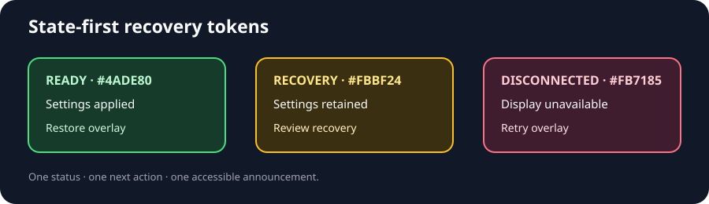
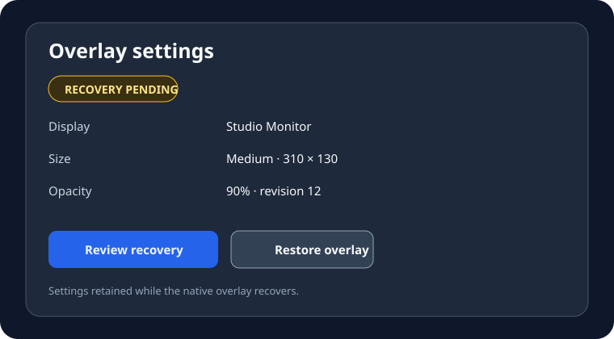
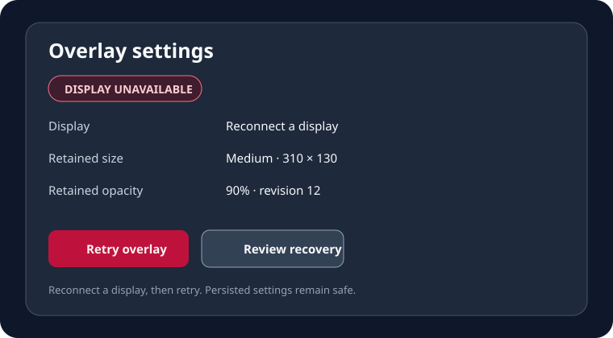
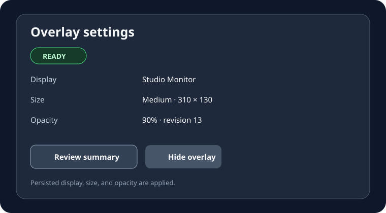
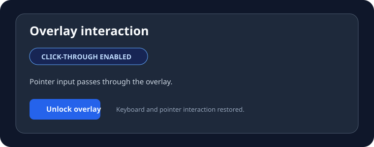

# Overlay recovery design system

The recovery workflow uses a small, state-first vocabulary so the control window
remains understandable during display and native-bridge failures.

| Token | Value | Use |
| --- | --- | --- |
| `surface.canvas` | `#111827` | dark control-window canvas |
| `state.ready` | `#4ade80` | overlay is restored and settings applied |
| `state.recovery` | `#fbbf24` | persisted settings need review |
| `state.disconnected` | `#fb7185` | display or bridge must reconnect |
| `action.primary` | `Review recovery` | focus the persisted settings summary |
| `action.restore` | `Restore overlay` | apply retained settings and show overlay |
| `action.retry` | `Retry overlay` | retry after a display reconnects |

The status card is always paired with one next action. Status copy is concise,
while `Accessible.name`, `Accessible.value`, and `Accessible.description` carry
the state, revision, and recovery instruction for assistive technology.

The settings card keeps the state, retained values, and next action in one scan:

When no display is available, the same card keeps the recovery action stable and
changes only the next-step copy:

The ready state keeps the same hierarchy while making the successful restore
visually quiet:

Interaction mode uses the same status-card hierarchy so click-through state is
visible without competing with recovery actions:

