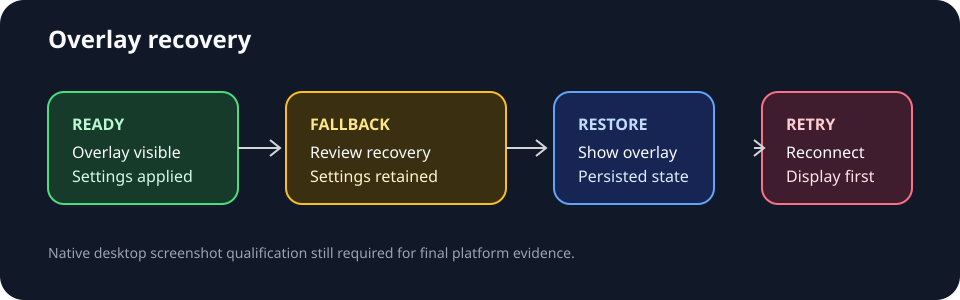

# Overlay recovery workflow

The control window keeps one predictable recovery path visible whenever the native
overlay is unavailable or its persisted settings need attention.



```text
Ready ── display/bridge loss ──> Fallback visible + Review recovery
  ▲                                  │
  │                                  ├─ connected: review settings → Restore overlay
  │                                  └─ disconnected: reconnect display → Retry overlay
  └────────────── successful restore ┘
```

The fallback status is intentionally a status card, not a modal error. It keeps
the live monitoring controls available, states whether recovery is pending, and
offers a keyboard-focusable `Review recovery` action that moves focus to the
persisted display/size/opacity summary. The summary and action announce the
settings revision and the next recovery step through the accessibility tree.

Each explicit `Retry overlay` request is counted in the control window and
announced as a numbered attempt. The count resets when a native bridge or
compatible display becomes available, so retry feedback stays bounded and
does not imply that capture itself was restarted.

Recovery permits three attempts before the retry action enters a safe-mode
state. Reconnect a display or change recovery settings to leave that state.
The control window also exposes `Clear safe mode` so a user can deliberately
start another bounded recovery cycle after checking the display connection.
While safe mode is active, a status message remains visible and explicitly
states that monitoring continues without the native overlay.
Clearing safe mode returns focus to the overlay recovery page so the next
retry is visible and keyboard-ready immediately.
The same action is available from the keyboard with `Ctrl+Alt+Shift+C`.
The safe-mode card repeats that shortcut next to the status so recovery remains
discoverable without opening a separate help view.
During an active retry cycle, the card also shows bounded progress such as
`Recovery attempts: 1/3` so the next action and remaining budget are clear.
Users can choose `Stop recovery` before the limit to pause retries while
leaving monitoring available; starting a new retry cycle remains explicit.
The same action is available from the keyboard with `Ctrl+Alt+Shift+X` while
an active retry cycle is in progress.
The active recovery card repeats this shortcut next to the Stop recovery action
so pausing a retry remains discoverable.
After `Stop recovery`, the card keeps a persistent `Recovery paused · monitoring
continues` status so an intentional user pause is distinguishable from a native
bridge failure; the next retry remains an explicit action.
Focus moves directly to `Resume recovery` when the pause is requested, keeping
the next lifecycle action keyboard-ready instead of targeting a hidden control.
The paused card also exposes `Resume recovery`, which starts a fresh bounded
attempt without requiring the user to rediscover the retry control.
For keyboard-first recovery, `Ctrl+Alt+Shift+R` performs the same resume action;
the shortcut is repeated beside the paused action while it is available.
Reapply saved settings uses `Ctrl+Alt+Shift+A` so it does not collide with the
paused recovery resume shortcut.
Pressing `Escape` while paused returns focus to `Resume recovery`, providing a
predictable keyboard path back to the lifecycle action after reviewing status.
It also announces that the paused recovery action is focused for assistive
technology users.
`Ctrl+Alt+Shift+Pause` opens the paused recovery page from anywhere in the
control window, restores the control window if it was hidden, and focuses
`Resume recovery` for a complete keyboard workflow.
The shortcut is safe to repeat: it reopens the same recovery page and restores
the same focus target without starting a retry by itself.
The page shortcut is only active while the pause state is live and disappears
with its hint as soon as recovery is resumed.
If a display is disconnected and later restored while recovery is paused, focus
returns to `Resume recovery` rather than the ordinary retry control, preserving
the intentional pause across the display lifecycle.
If click-through is enabled at the same time, Escape remains reserved for the
native unlock workflow; the paused-recovery focus shortcut yields to it.
If unlocking fails, focus remains on the visible Unlock overlay action so the
failure can be retried without losing the interaction workflow.
The control window is also restored and activated before that focus is applied,
so a failed unlock from the hidden overlay still leaves an actionable fallback.
The fallback also shows an explicit unlock-failure status while click-through
remains active, making the next retry state visible to assistive technology.
After a successful unlock, the fallback and recovery-pending markers are cleared
so the interaction status returns to the ready state.
Changing click-through successfully from the control window applies the same
transition and clears stale recovery markers.
Successful click-through changes also announce the resulting interaction mode,
so keyboard and pointer availability is explicit to assistive technology.
The persisted visibility choice is also retained across visual-state recovery:
an overlay hidden by the user remains hidden until Restore overlay is chosen.
Persisted opacity is likewise reapplied during visual-state recovery and remains
part of the settings revision announced to the control window.
The click-through status also prints `Ctrl+Alt+U` next to the Escape guidance,
making the keyboard path to the Unlock action visible without opening help.
Using `Ctrl+Alt+U` also restores and activates the control window before focus
is moved to Unlock overlay, so the action remains reachable when the overlay
has hidden the controls.
The `Ctrl+Alt+K` click-through focus shortcut likewise restores and activates
the control window before focusing the interaction toggle.
The `Ctrl+Alt+L` opacity focus shortcut follows the same rule before focusing
the opacity control.
The `Ctrl+Alt+Z` size focus shortcut also restores and activates the control
window before focusing the overlay size control.
The Show and Hide overlay focus shortcuts restore and activate the control
window before focusing their respective lifecycle actions as well.
Restore, Retry, Reapply settings, and retained-settings review focus shortcuts
follow the same control-window restoration rule.
The display-selection focus shortcut also restores and activates the control
window before focusing display selection.
The reconnect announcement also states that recovery remains paused, so a
display reconnect cannot silently restart native retries.
While the display is still unavailable, the paused card separately reports that
display recovery is pending and that resuming remains a manual choice.
When the display returns, no native recovery attempt is started automatically
while paused; the user must choose `Resume recovery`.
Geometry updates received during that paused interval follow the same rule and
only refresh persisted state; they do not trigger a hidden retry.
The same manual boundary applies when the native bridge itself returns after an
availability loss: a previously visible overlay is not silently relaunched.
Choosing the explicit `Show overlay` action is itself a deliberate resume and
clears the paused marker before launching the native window.
If the native bridge is still unavailable, that action keeps the paused marker
intact while restoring the control-window fallback.

## Screenshot qualification

When desktop rendering is available, capture these states at the standard desktop
viewport and attach the images to the UI qualification issue:

1. Ready overlay with the settings summary.
2. Connected fallback with `Review recovery` and `Restore overlay` guidance.
3. Disconnected-display fallback with `Retry overlay` guidance.
4. Successful restore with the updated settings revision announcement.

The contract test checks the stable object names and copy used by these states;
native desktop screenshots remain required evidence for platform qualification.

The saved display identity is restored by name rather than only by its old index, and a successful recovery announcement names the display that was reconnected. This keeps display continuity understandable when the operating system reorders screens after reconnecting them.


Persisted geometry is restored with the saved display and included in the successful recovery announcement as width and height. This gives keyboard and assistive-technology users confirmation that the overlay returned at its saved size, not merely that the native window reopened.


Display, geometry, and opacity are treated as one persisted visual bundle: recovery confirms all three in a single announcement, while the control window remains the tray/taskbar fallback if any part cannot be reapplied.


When the native overlay is unavailable, invoking Show or Restore is safe from a hidden control window: the tray/taskbar fallback is made visible and active, recovery remains pending, and focus lands on display recovery so the next action is keyboard-ready.


Fallback activation does not discard the selected display or size preference: when the native bridge is unavailable, the tray/taskbar control window announces that those persisted settings remain queued for the next retry.


The fallback review action keeps persisted display, geometry, opacity, and interaction settings keyboard-ready: activating it focuses the settings-retention summary without changing or discarding the queued recovery state.


When the native bridge returns with a usable display, the control window is explicitly reactivated and focus moves to Review retained settings. This makes the persisted display/geometry/opacity state keyboard-discoverable before the user chooses Show, Restore, or Reapply.


The retained-settings shortcut Ctrl+Alt+Shift+S remains enabled during fallback, restores the control window, and focuses the review action without changing persisted display, geometry, opacity, or interaction settings.


The Retry overlay focus shortcut Ctrl+Alt+Shift+Y remains available while the bridge is unavailable. It restores the control window, focuses Retry overlay, and leaves persisted display and geometry preferences untouched for the retry.


A native bridge loss now restores the control window and focuses Retry overlay immediately, while retaining the saved display and size settings. This makes the next recovery action keyboard-ready without discarding the pending visual state.


If a retry reaches the native bridge but Show fails, focus stays on Retry overlay after the control-window fallback is restored. The saved display and geometry remain queued, so the user can retry without reselecting settings.


Clearing overlay safe mode with Ctrl+Alt+Shift+C resets only the bounded retry counter: focus returns to Retry overlay while saved display and geometry preferences remain intact for the next attempt.


Stopping recovery with Ctrl+Alt+Shift+X pauses retries without clearing persisted display, geometry, opacity, or interaction settings; focus moves to Resume recovery so the same state can be resumed deliberately.


Resuming paused recovery with Ctrl+Alt+Shift+R starts a fresh bounded attempt but keeps the saved display and geometry preferences unchanged, so the user can resume the same visual state deliberately.


While recovery is paused, Escape re-focuses Resume recovery without changing the queued display or geometry settings. This gives keyboard users a stable return path after reviewing the retained visual state.

